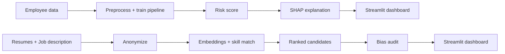

# HR Analytics Suite


Two end-to-end, explainable HR analytics projects in one repository:

1. **Employee Attrition Prediction**: predicts who is likely to leave and explains *why*.
2. **AI Resume Screener**: ranks resumes against a job description and audits the shortlist for bias.

Both come with interactive Streamlit dashboards, automated tests and CI.

---

## Table of Contents
- [Why this project](#why-this-project)
- [Features](#features)
- [Tech stack](#tech-stack)
- [How it works](#how-it-works)
- [Getting started](#getting-started)
- [Usage](#usage)
- [Using real data](#using-real-data)
- [Results](#results)
- [Project structure](#project-structure)
- [Testing](#testing)
- [Roadmap](#roadmap)
- [Responsible use](#responsible-use)
- [Author](#author)
- [License](#license)

---

## Why this project

HR teams make high-impact decisions about hiring and retention, often with little transparency. This suite shows how ML can support those decisions **while staying explainable and auditable**:

- Attrition risk is shown together with the factors driving it (SHAP), not just a score.
- Resume ranking includes a built-in fairness audit and a blind-screening mode.

---

## Features

### 1. Attrition Prediction
- Gradient Boosting classifier inside a single scikit-learn `Pipeline` (one-hot encoding + model)
- Per-employee **risk score** with a **SHAP waterfall** plot showing what pushes risk up or down
- **Batch mode**: upload a CSV and get risk bands (Low / Medium / High)
- Department-level average risk and **global SHAP summary** of top drivers
- Works out of the box on synthetic data, and supports the real IBM HR Analytics dataset

### 2. AI Resume Screener
- **Semantic matching** using sentence-transformers (`all-MiniLM-L6-v2`), with automatic TF-IDF fallback
- **Hybrid score** = semantic similarity + skill coverage, with an adjustable weight slider
- **Skill-gap column** showing which JD skills each candidate is missing
- **Blind screening mode** that strips names, emails and phone numbers before scoring
- **Bias audit** on the shortlist: selection rate and impact ratio per group (gender, college tier) using the four-fifths (80%) rule, with warnings when a group falls below 0.8

---

## Tech stack

| Area | Tools |
|---|---|
| Language | Python |
| ML | scikit-learn, SHAP |
| NLP | sentence-transformers, TF-IDF |
| Data | pandas, NumPy |
| App | Streamlit, Matplotlib |
| Quality | pytest, GitHub Actions |

---

## How it works



---

## Getting started

### Prerequisites
- Python 3.10 or newer
- Git

### Installation
```bash
git clone https://github.com/jayan2005-ux/hr-analytics-suite.git
cd hr-analytics-suite

python -m venv .venv
source .venv/bin/activate        # Windows: .venv\Scripts\activate

pip install -r requirements.txt
```

Optional, for better semantic matching in the screener:
```bash
pip install sentence-transformers
```

---

## Usage

### Attrition Prediction
```bash
python attrition_prediction/train.py
streamlit run attrition_prediction/app.py
```

### Resume Screener
```bash
streamlit run resume_screener/app.py
```

**Resume CSV format** for your own data: columns `id`, `text`, and optionally `gender` and `college_tier` (needed for the bias audit).

---

## Using real data

By default, the attrition model trains on a synthetic dataset that follows the IBM HR Analytics schema, so the project runs instantly. To use the real data:

1. Download **IBM HR Analytics Employee Attrition & Performance** from Kaggle.
2. Run:
   ```bash
   python attrition_prediction/train.py --data WA_Fn-UseC_-HR-Employee-Attrition.csv
   ```
3. Start the app again with `streamlit run attrition_prediction/app.py`.

---

## Results

| Project | Metric | Value | Data |
|---|---|---|---|
| Attrition Prediction | ROC-AUC | ~0.72 | Synthetic (demo) |
| Attrition Prediction | ROC-AUC | _add after training_ | IBM HR Analytics |

> Replace the second row with your real metrics, and add dashboard screenshots to a `docs/` folder, for example:
>
> ``
> ``

---

## Project structure

```
hr-analytics-suite/
├── attrition_prediction/
│   ├── data_gen.py        # synthetic data in IBM HR schema
│   ├── train.py           # training pipeline + evaluation
│   └── app.py             # Streamlit dashboard with SHAP
├── resume_screener/
│   ├── screener.py        # ranking, skill match, anonymizer, bias audit
│   └── app.py             # Streamlit dashboard
├── tests/                 # pytest suites for both projects
├── docs/                  # screenshots
├── .github/workflows/     # CI pipeline
├── requirements.txt
├── LICENSE
└── README.md
```

---

## Testing

```bash
pytest -q
```

CI runs training and the full test suite on every push and pull request.

---

## Roadmap

- [ ] XGBoost / LightGBM comparison and threshold tuning
- [ ] Class imbalance handling (SMOTE / class weights)
- [ ] PDF and DOCX resume parsing
- [ ] Name-swap bias test for the screener
- [ ] Cross-encoder reranking for the top candidates
- [ ] Fairness check on attrition predictions
- [ ] Deploy both apps on Streamlit Community Cloud

---

## Responsible use

These tools are **decision-support demos**, not systems for automated hiring or firing. In real-world use:

- Keep a human in the loop for every decision.
- Audit models for bias regularly and on your own data.
- Follow applicable data-protection and employment laws.
- Do not rely on a single score to judge a person.

---

## Author

**Jayan Shrivastava**
B.Tech Computer Science, ITM Gwalior

[LinkedIn](https://linkedin.com/in/jayan-shrivastava-189076406) | [GitHub](https://github.com/jayan2005-ux)

---

## License

Released under the [MIT License](LICENSE).
